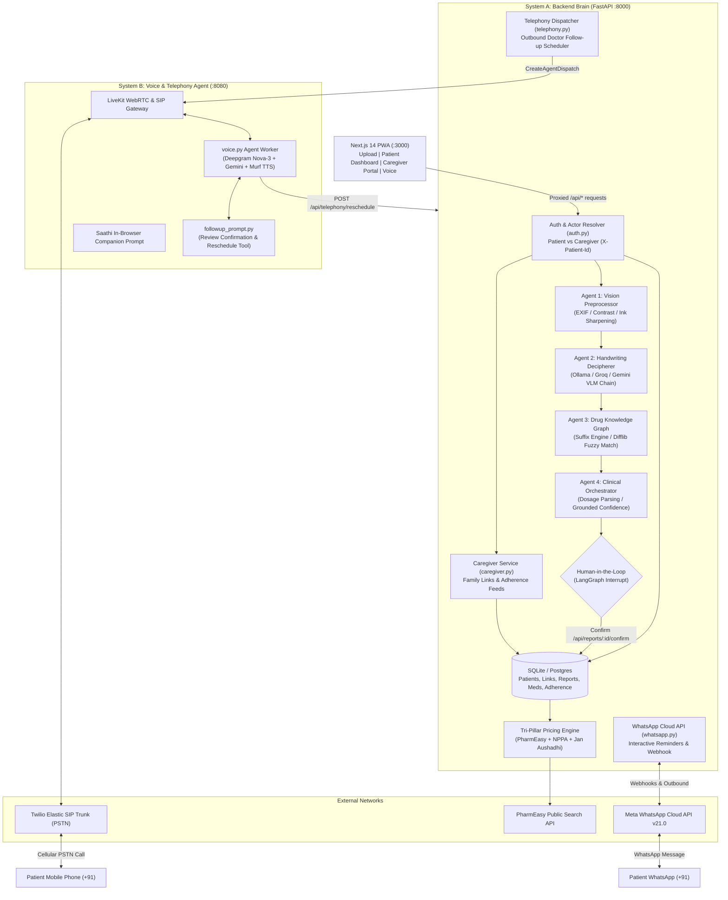
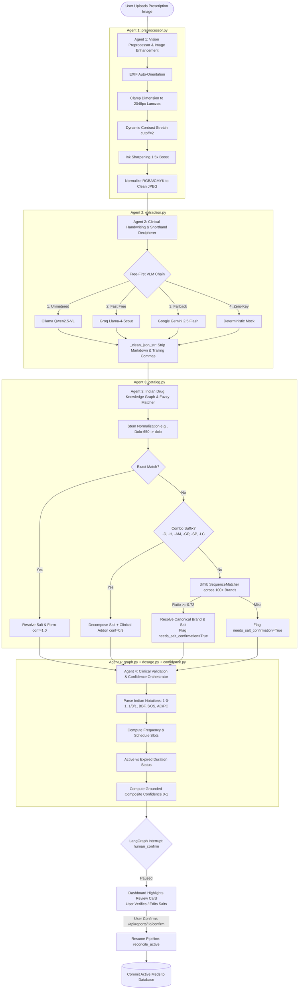
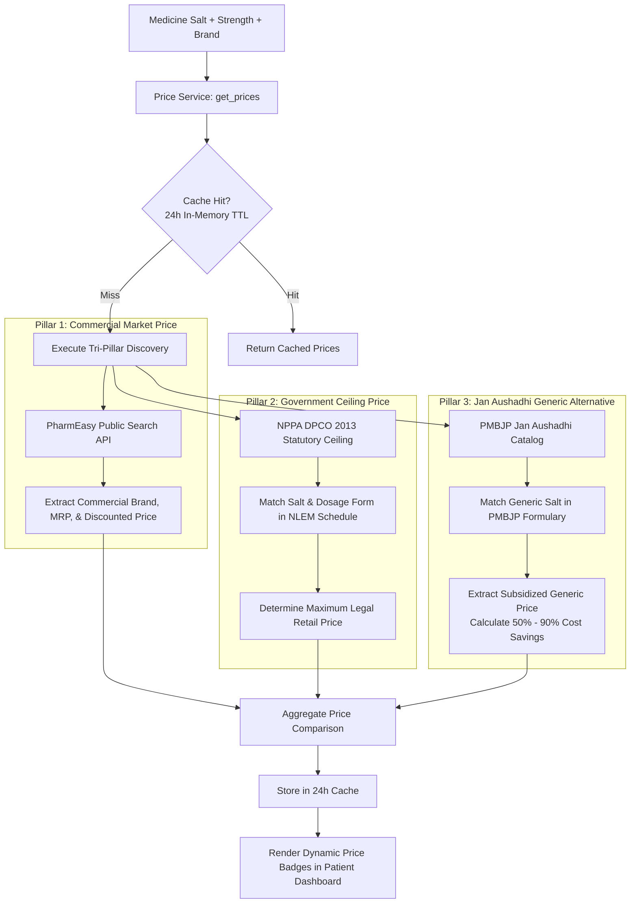
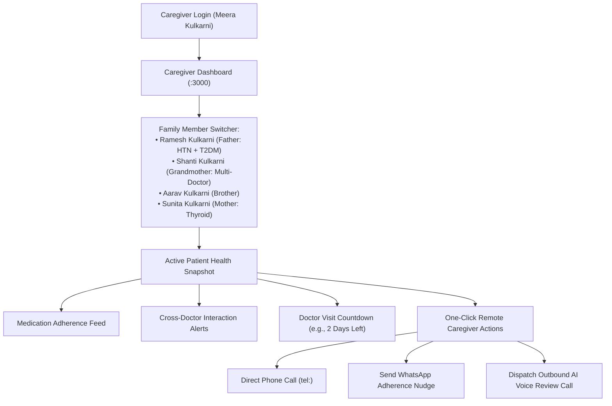
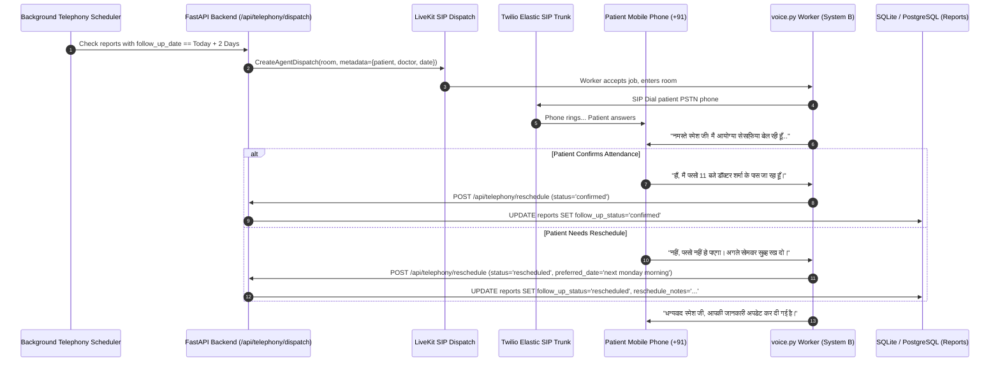
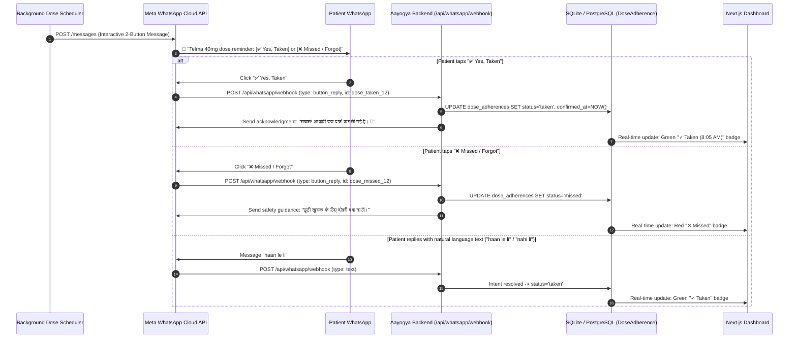

# Aayogya (आयोग्या)

> **Click your prescription** ➔ AI deciphers doctor handwriting, explains it in your language, flags drug interactions, compares real-time medicine prices across Jan Aushadhi & PharmEasy, coordinates remote family caregivers, and sends automated WhatsApp / outbound voice follow-ups — while deferring every clinical decision to your registered medical practitioner.

**Aayogya** is an India-first medication-adherence and prescription-intelligence platform. It is deliberately **non-clinical**: under India's Telemedicine Practice Guidelines 2020 (§5.4), an AI platform may not diagnose or prescribe. Aayogya only *explains, navigates, compares prices, coordinates caregivers, and reminds* — keeping every clinical decision in the hands of a registered medical practitioner.

Full architecture specifications live in [`DESIGN.md`](../DESIGN.md), caregiver architecture in [`caregiver.md`](../caregiver.md), and outbound telephony details in [`voice.md`](../voice.md).

---

## Key Capabilities

- **4-Agent Handwriting Extraction Pipeline** — Multi-agent vision & language system that enhances smartphone photos, deciphers messy doctor cursive, fuzzy-matches against 100+ Indian drug brands, parses Indian dosage notations (`1-0-1`, `1/0/1`, `BBF`, `SOS`), and halts at a Human-in-the-Loop gate.
- **Tri-Pillar Medicine Pricing Engine** — Real-time price discovery comparing **PharmEasy** commercial rates, **NPPA (DPCO)** statutory ceiling prices, and **PMBJP Jan Aushadhi** generic store prices (up to 90% savings) with 24-hour caching.
- **Caregiver Portal & Family Health Management** — Remote family member persona (e.g., adult child managing elderly parents in another city) with a unified multi-patient switcher, DPDP-aligned consent, live adherence monitoring, and one-click actions: direct call, WhatsApp reminder, or AI-agent dispatch.
- **Autonomous AI Telephony Follow-Up Calls** — Ultra-low latency voice agent that calls patients **2 days prior** to scheduled doctor reviews via Twilio SIP + LiveKit, confirms attendance, negotiates reschedules in natural Hindi/English, and updates the clinic dashboard in real time.
- **Meta WhatsApp Cloud API (v21.0) Adherence** — Interactive 2-button daily reminders (`[✅ Yes, Taken]` / `[❌ Missed / Forgot]`) with zero paid middleware, natural Hindi text parsing, and fatigue protection.
- **Drug-to-Drug Interaction Checking** — Cross-checks active medications across multiple doctors/prescriptions to flag dangerous salt combinations before doses are taken.
- **Nearby Chemists & Jan Aushadhi Kendras** — Live OpenStreetMap / Overpass geolocation map of nearby retail pharmacies and government Jan Aushadhi Kendras.
- **Local Role-Based Authentication** — Stateless HMAC bearer token system with instant persona switching between patients (`Ramesh`, `Shanti`) and caregivers (`Meera`).

---

## System Architecture



---

## 1. The 4-Agent Extraction Pipeline

Handwritten Indian prescriptions are notorious for illegible doctor cursive, inconsistent dosage shorthand, and combination brand names. Aayogya solves this using a specialized **4-Agent LangGraph Pipeline**:



### Breakdown of the 4 Agents:

1. **Agent 1: Vision Preprocessor & Image Enhancement ([`app/preprocessor.py`](backend/app/preprocessor.py))**
   - **EXIF Auto-Orientation:** Fixes sideways or upside-down mobile photos automatically.
   - **Dynamic Contrast Stretching & Ink Sharpening:** Enhances faint ballpoint/gel pen strokes (`ImageEnhance.Sharpness(1.5)` and `ImageOps.autocontrast(cutoff=2)`), clearing gray paper shadows.
   - **Dimension Optimization:** Binds images to 2048px max dimension to prevent vision model memory overflow.
   - **Safety:** Handles RGBA/CMYK modes and gracefully recovers from corrupt image payloads without failing the request.

2. **Agent 2: Clinical Handwriting & Shorthand Decipherer ([`app/extraction.py`](backend/app/extraction.py))**
   - Uses an expert prompt tailored to Indian clinical handwriting (cursive loops, abbreviations, combination suffixes).
   - **Free-First Fallback Chain:** Ollama (`Qwen2.5-VL-7B`) $\to$ Groq (`Llama-4-Scout`) $\to$ HF Router $\to$ Gemini $\to$ Deterministic Mock.
   - **Defensive JSON Sanitizer:** `_clean_json_str` strips markdown backticks, conversational preamble, and trailing commas.

3. **Agent 3: Indian Drug Knowledge Graph & Fuzzy Matcher ([`app/catalog.py`](backend/app/catalog.py))**
   - Powered by a comprehensive knowledge base ([`indian_medicines.json`](backend/app/data/indian_medicines.json)) covering top prescribed Indian brands across all therapeutic classes.
   - **Suffix Clinical Engine:** Recognizes combination suffixes:
     - `-D` / `-DSR` $\to$ *+ Domperidone* (e.g., `Pan-D`)
     - `-H` $\to$ *+ Hydrochlorothiazide* (e.g., `Telma-H`)
     - `-AM` $\to$ *+ Amlodipine* (e.g., `Telma-AM`)
     - `-GP` $\to$ *+ Glimepiride* (e.g., `Glycomet-GP`)
     - `-SP` $\to$ *+ Serratiopeptidase* (e.g., `Zerodol-SP`)
     - `-LC` $\to$ *+ Levocetirizine* (e.g., `Montair-LC`)
   - **Fuzzy Matcher:** Uses `difflib.SequenceMatcher` to resolve cursive doctor misspellings (`"Agmntin"` $\to$ *Augmentin / Amoxicillin + Clav*, `"Dlo"` $\to$ *Dolo / Paracetamol*, `"Zerol-SP"` $\to$ *Zerodol-SP*).
   - **Safety Rule:** Every fuzzy match automatically triggers `needs_salt_confirmation = True` with an explanatory note.

4. **Agent 4: Clinical Validation & Confidence Orchestrator ([`app/graph.py`](backend/app/graph.py), [`app/dosage.py`](backend/app/dosage.py), [`app/confidence.py`](backend/app/confidence.py))**
   - **Indian Dosage Parser:** Translates Indian shorthand into precise daily schedules:
     - `1-0-1` / `1/0/1` $\to$ Morning + Night (2 doses/day)
     - `1-1-1` $\to$ Morning + Afternoon + Night (3 doses/day)
     - `BBF` / `empty stomach` $\to$ Morning Before BreakFast
     - `bedtime` / `HS` $\to$ Night
     - `SOS` / `PRN` $\to$ Marked as `prn=True` (never auto-scheduled)
   - **Grounded Confidence Scoring:** Blends catalog match certainty (40%), dosage parsability (20%), strength detection (10%), and model self-report (30%).
   - **Human-in-the-Loop Gate:** Interrupts LangGraph execution before any medicine is saved as active. The patient confirms or edits via the dashboard card, preventing misidentified medicines from entering interaction checks.

---

## 2. Tri-Pillar Medicine Pricing Engine

Aayogya integrates a **Tri-Pillar Pricing Engine** ([`app/prices.py`](backend/app/prices.py)) that gives patients total transparency over medicine costs across retail pharmacies and government generic initiatives with **zero paid API keys**:



### The Three Pricing Pillars:

| Pillar | Source | Description | Typical Savings |
|---|---|---|---|
| **1. Commercial Retail** | **PharmEasy Search API** | Live market price from major Indian online pharmacy (e.g., Dolo 650 ~₹30–34). | Baseline MRP & retail discounts |
| **2. Statutory Ceiling** | **NPPA (DPCO 2013)** | Official government ceiling price under the National List of Essential Medicines (NLEM). Legally caps the maximum price any pharmacy can charge. | Regulates high-cost branded drugs |
| **3. Generic Alternative** | **PMBJP Jan Aushadhi** | Pradhan Mantri Bhartiya Janaushadhi Pariyojana public generic catalog (e.g., Paracetamol 650mg at ~₹5.50 for 10 tablets). | **50% to 90% savings** |

---

## 3. Caregiver Portal & Family Health Management

In Indian households, health management is rarely individual — adult children often coordinate care for elderly parents living across the country. Aayogya implements a dedicated **Caregiver Portal** ([`caregiver.md`](../caregiver.md), [`backend/app/caregiver.py`](backend/app/caregiver.py), [`frontend/components/Caregiver.js`](frontend/components/Caregiver.js)):



### Caregiver System Highlights:
- **DPDP-Aligned Consent:** Patients explicitly grant access to caregivers via [`CaregiverLink`](backend/app/models.py). The caregiver only sees family members who have granted active consent.
- **Unified Actor Resolution Seam:** The backend (`resolve_actor` in [`auth.py`](backend/app/auth.py)) inspects the `X-Patient-Id` header. Caregivers seamlessly view and act on behalf of the selected relative without creating parallel redundant endpoints.
- **Family Switcher:** Instant tabs in the frontend dashboard allow switching between elderly parents with live medication statuses, review cards, and today's doses.
- **Action Drawer:** Allows the caregiver to trigger a phone call, send an immediate WhatsApp reminder, or schedule an autonomous AI voice check-in.

---

## 4. Autonomous Telephony & Doctor Follow-Up (System B)

Aayogya features an **outbound conversational telephony agent** ([`voice.md`](../voice.md), [`backend/app/telephony.py`](backend/app/telephony.py), [`agent/voice.py`](agent/voice.py), [`agent/followup_prompt.py`](agent/followup_prompt.py)) designed to reduce clinic no-show rates across India:



### Sub-400ms Zero Perceived Latency Blueprint:
1. **LiveKit SIP Gateway + Twilio Elastic SIP Trunk** delivers raw G.711 / Opus cellular audio directly to standard Indian mobile phones (no smartphone or app required).
2. **Noise Suppression:** `BVCTelephony()` cleans cellular line hum and street noise.
3. **Deepgram Nova-3:** Handles rapid Hindi/English code-switching with `endpointing=250ms`.
4. **Google Gemini 2.5 Flash:** Follow-up prompt maintains conversational flow and calls the `reschedule_appointment` tool.
5. **Murf Falcon-2 TTS (`hi-IN`):** Sub-100ms Hindi voice streaming directly into the SIP channel.
6. **Zero-Key Simulation Mode:** When SIP credentials are absent, the system simulates dispatches and records test logs with zero runtime crashes.

---

## 5. Meta WhatsApp Cloud API & Interactive Adherence

Aayogya integrates direct 2-way medication adherence messaging via the **official Meta WhatsApp Business Cloud API (v21.0)** with **zero paid middleware or third-party fees**:



### Notification Fatigue & Patient Privacy Control:
- **Master WhatsApp & Voice Toggles:** Patients can pause automated WhatsApp notifications or phone calls with a single toggle in settings.
- **"I'm Feeling Fit / Stop Medicine" Action:** Once a patient finishes an antibiotic course or acute medication, stopping the medicine immediately archives remaining doses and stops all notifications.
- **IST Scheduled Windows:** Reminders only dispatch during daytime hours (09:00–20:00 IST).

---

## Repository Structure

```
Aayogya/
├── backend/                       System A — FastAPI Backend Brain
│   ├── alembic/                   Database schema migrations
│   ├── app/
│   │   ├── preprocessor.py        Agent 1: Vision Preprocessor & Image Enhancement
│   │   ├── extraction.py          Agent 2: Clinical Handwriting & VLM Decipherer
│   │   ├── catalog.py             Agent 3: Indian Drug Knowledge Graph & Suffix Engine
│   │   ├── dosage.py              Agent 4: Indian Dosage Notation Parser
│   │   ├── confidence.py          Composite Grounded Confidence Scorer
│   │   ├── graph.py               LangGraph HITL StateGraph Workflow
│   │   ├── prices.py              Tri-Pillar Pricing Engine (PharmEasy / NPPA / PMBJP)
│   │   ├── whatsapp.py            Meta WhatsApp Business Cloud API Integration
│   │   ├── telephony.py           Outbound Doctor Follow-up SIP Dispatcher
│   │   ├── caregiver.py           Caregiver Links, Family Resolver & Actions
│   │   ├── auth.py                HMAC Bearer Auth & Actor Resolution (X-Patient-Id)
│   │   ├── summary.py             Patient Summary & Doctor Visit Countdown
│   │   ├── interactions.py        Drug-to-Drug Interaction Checking
│   │   ├── data/
│   │   │   ├── indian_medicines.json       100+ Indian brands, salts & forms
│   │   │   ├── medicine_pricing_dataset.json Expanded pricing dataset
│   │   │   └── medicine_pricing_dataset.csv  CSV dataset of medicine pricing
│   │   ├── main.py                FastAPI Application, Router & Endpoints
│   │   ├── models.py              SQLAlchemy Database Models
│   │   ├── schemas.py             Pydantic v2 Request/Response Schemas
│   │   └── seed.py                Database Seeder (Ramesh, Shanti, Meera, Aarav, Sunita)
│   ├── test_multiagent_extraction.py  Comprehensive 4-Agent Pipeline Test Suite
│   ├── test_whatsapp.py               WhatsApp Cloud API & Webhook Test Suite
│   ├── test_telephony.py              Outbound Telephony & Rescheduling Test Suite
│   ├── test_caregiver.py              18/18 Caregiver Role & Isolation Test Suite
│   ├── test_dosage.py                 Dosage Notation Parser Unit Tests
│   └── test_confidence.py             Confidence Scoring Unit Tests
├── frontend/                      Next.js 14 PWA (App Router, GSAP, Leaflet)
│   ├── app/
│   │   ├── page.js                App Root (Patient Dashboard & Caregiver Portal)
│   │   ├── layout.js              Root Layout with Aura Background
│   │   └── globals.css            Design System, Dark Theme & Tailwind Styles
│   ├── components/
│   │   ├── Dashboard.js           Patient Dashboard Shell
│   │   ├── Caregiver.js           Caregiver Family Portal & Quick Actions
│   │   ├── Login.js               Quick-Login Persona Switcher & Custom Login
│   │   ├── LiveVoiceAgent.js      Realtime LiveKit WebRTC Voice Interface
│   │   ├── Assistant.js           AI Companion Text & Voice Chat Interface
│   │   ├── Pharmacies.js          Leaflet Map of Nearby Chemists & Jan Aushadhi Kendras
│   │   ├── Landing.js             Interactive Hero & Feature Showcase
│   │   ├── sections.js            Overview, Meds, Timeline, Interactions & Pricing
│   │   └── ui.js                  Price Badges, Review Cards, Metric Cards
│   ├── lib/
│   │   ├── api.js                 Authenticated Fetch Client & X-Patient-Id Header
│   │   └── gsap.js                Smooth Scroll & Interactive Animations
│   └── next.config.mjs            Next.js Proxy Rewrites (/api/* -> :8000, /agent/* -> :8081)
└── agent/                         System B — Voice & Follow-up Companion
    ├── voice.py                   Realtime WebRTC Voice Worker & Telephony Dial
    ├── followup_prompt.py         Outbound Doctor Follow-up Telephony Persona
    ├── prompt.py                  Saathi Companion Persona
    ├── chat.py                    FastAPI Chat Server with Tool Calling
    ├── backend_client.py          Authenticated Backend Client for Agent Tools
    ├── test_agent.py              Companion Prompt & Routing Unit Tests
    └── test_followup.py           Telephony Agent Rescheduling Tests
```

---

## Quick Start

### Port Allocation:
- **Backend (FastAPI):** Port **8000** (`http://localhost:8000`)
- **Frontend (Next.js):** Port **3000** (`http://localhost:3000`)
- **Voice/Chat Agent (LiveKit/FastAPI):** Port **8080** / **8081**

> **Note on Port 8000:** The frontend automatically proxies all `/api/*` network requests to `http://127.0.0.1:8000` via Next.js rewrites (`next.config.mjs`). Always launch the backend on port **8000**.

### 1. Backend (FastAPI + LangGraph) — Port 8000

```bash
cd backend

# Create and activate virtual environment
python -m venv .venv
.venv\Scripts\activate       # On Windows (or source .venv/bin/activate on macOS/Linux)

# Install dependencies
pip install -r requirements.txt

# Run migrations & launch server on port 8000
python -m uvicorn app.main:app --reload --port 8000
```

> **Zero-Key Out of the Box:** The backend works immediately with zero API keys. Extraction defaults to deterministic mock or local Ollama, and SQLite is initialized and seeded automatically.

### 2. Frontend (Next.js 14 PWA) — Port 3000

```bash
cd frontend

npm install
npm run dev
```

Visit **`http://localhost:3000`** in your browser.

#### Demo Quick-Login Personas:
- **Caregiver Persona (Meera Kulkarni):** Log in as `meera@demo.in` / `pass1234` to access the Caregiver Portal and manage father Ramesh and grandmother Shanti.
- **Patient Persona (Ramesh Kulkarni):** Log in as `ramesh@demo.in` / `pass1234` to test individual prescription upload, adherence tracking, and pricing comparison.
- **High-Risk Interaction Persona (Shanti Kulkarni):** Log in as `shanti@demo.in` / `pass1234` to view cross-doctor drug interaction warnings.

### 3. Voice Companion & Telephony Worker (System B) — Port 8080

```bash
cd agent

python -m venv .venv
.venv\Scripts\activate
pip install -r requirements.txt

# Start LiveKit Voice Worker
python voice.py dev

# Or start the Text Chatbot API
uvicorn chat:app --reload --port 8080
```

---

## Testing & Verification

A comprehensive test suite verifies each subsystem and safety boundary:

```bash
cd backend
.venv\Scripts\activate

# 1. Run 4-Agent Pipeline test suite (EXIF, JSON sanitizing, fuzzy matching, LangGraph HITL)
python test_multiagent_extraction.py

# 2. Run Caregiver data isolation and patient linking test suite (18/18 passing)
python test_caregiver.py

# 3. Run Outbound Telephony & appointment reschedule test suite
python test_telephony.py

# 4. Run WhatsApp Meta Cloud API adherence and webhook test suite
python test_whatsapp.py

# 5. Run Indian dosage parser & confidence scoring unit tests
python test_dosage.py
python test_confidence.py

# 6. Run Telephony Voice Agent follow-up tests
cd ../agent
python test_followup.py
python test_agent.py
```

---

## Disclaimer

Aayogya is **not a substitute for professional medical advice, diagnosis, or treatment**. Under India's Telemedicine Practice Guidelines 2020, Aayogya never prescribes medication, modifies clinical regimens, or alters dosages. Always consult a registered medical practitioner with any health-related questions. In a medical emergency in India, call **108** immediately.
