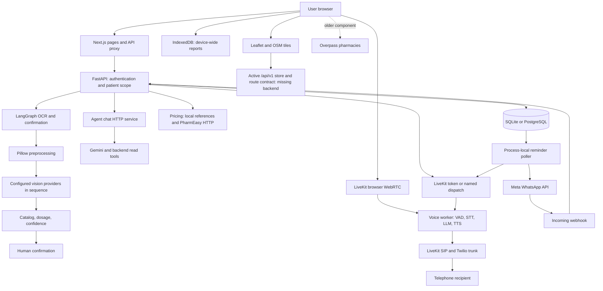

# Architecture audit

Audit window: 2026-10-24 to 2026-10-25, Asia/Kolkata. Scope: existing application, initial audit only. No application fixes, environment edits, migrations against the user's database, live messages, calls, or billable model requests were authorized or performed in this audit.

## Repository access and coverage

The runnable repository is `Aayogya/` inside the supplied `Aaroya/` workspace. It contains the frontend, backend, agent, five Alembic revisions, datasets, and tests. The outer workspace also has design documents and archives. A clone is unnecessary. `git submodule status` fails because `agent/.reference-aushadh` is a Git link without a corresponding `.gitmodules` mapping. That reference repository is not a runtime dependency of the application inspected here; its historical content was not audited.

The starting worktree already contained the previous SQLite repair changes and staged removal of database sidecars. They were preserved. Audit additions are confined to this directory; build/test outputs also use normal generated directories and temporary databases. Never treat existing uncommitted changes as audit implementation.

`evidence/inventory.json` inventories 160 first-party text/data files, with line counts and hashes. `evidence/tracked-file-review-index.json` lists tracked text sources. Inventory is not a claim that every line of every document, generated dependency, archive, or dataset row received a manual review. All executable Python modules were syntax-parsed; the Next.js build checked JavaScript compilation. Manual tracing concentrated on all feature entrypoints, their clients, core service modules, schemas, migrations, data provenance, workers, and tests. No vendor dependency was reviewed line by line. Unknowns are identified in FEATURE_STATUS.md.

## Stack and execution units

| Unit | Installed/declared technology | Execution |
|---|---|---|
| Frontend | Next.js 14.2.35, React 18.3.1, Tailwind 3.4.19, GSAP 3.12.5 | Node 22.22.3; npm 11.11.0; production build passed |
| Map/audio browser clients | Leaflet 1.9.4, livekit-client 2.22.3 | Browser-only Leaflet import; WebRTC |
| Backend | FastAPI 0.115.6, Uvicorn 0.34.0, SQLAlchemy 2.0.36, Pydantic 2.10.4 | Python 3.11.9, separate virtual environment |
| OCR workflow | LangGraph 0.2.61; Pillow installed 12.3.0; google-generativeai 0.8.3; httpx 0.28.1 | Blocking vision calls offloaded to FastAPI threadpool |
| Persistence | SQLite default; optional psycopg/PostgreSQL; Alembic 1.14.0 | Startup migrations, metadata creation, SQLite-only column patches |
| Reminders | APScheduler 3.11.3 AsyncIOScheduler | A process-local 30-second polling job starts in every API lifespan |
| Agent | livekit-agents/plugins 1.8.3; google-genai 2.25.0 | Separate HTTP chat process and named voice worker |
| Speech | Deepgram Nova-3, Silero VAD, Gemini, Murf | Streaming STT/TTS; preemptive generation configured |
| Telephony | LiveKit API/SIP, configured Twilio trunk | Backend dispatches a job; voice worker performs the actual SIP dial |

Backend requirements mostly pin direct versions but do not provide a resolved lock. Agent requirements use ranges. The installed backend includes undeclared Pillow and LiveKit packages; an existing virtual environment conceals clean-install gaps. `pip check` passes in both existing environments, which does not establish reproducibility or vulnerability freedom. No application CI workflow or full-service production deployment manifest was found. Docker Compose starts PostgreSQL only, with local development credentials.

## Directory responsibilities

- `backend/app/main.py`: auth, upload/confirm, patient records, agent proxy, voice tokens, reminder and call endpoints.
- `backend/app/{graph,extraction,preprocessor,catalog,dosage,confidence}.py`: image preparation, provider chain, deterministic normalization and review state.
- `backend/app/{prices,interactions,conditions,summary}.py`: price references/live lookup, limited cited interaction rules, informational medicine uses, dashboard summaries.
- `backend/app/{whatsapp,telephony,caregiver}.py`: scheduling, Meta messages/webhooks, LiveKit dispatch/rescheduling, linked patient authorization.
- `backend/app/{auth,models,schemas,db,config,seed}.py`: persistence, signed bearer tokens, validation, runtime settings, opt-in synthetic accounts.
- `frontend/app/`: public pages, workspace, local prescription details, catch-all backend proxy.
- `frontend/components/sections.js`: older backend-connected dashboard features; `components/views/`: newer scanner/search/store/history screens using a different client contract.
- `frontend/lib/api.js`: backend `/api` client plus unconditional fallback fixtures. `lib/client.js`: `/api/v1` client plus independent hardcoded data and fake action results. `lib/indexedDb.js`: browser-local reports and action tokens.
- `agent/{voice,chat,backend_client,prompt,followup_prompt,config}.py`: conversation, tools, shared safety prompts, provider settings.
- `agent/demo.py`: explicitly local-only unauthenticated demo server; nevertheless reachable through the frontend rewrite if deployed there.

## Dependency and trust-boundary map

Critical boundary failures: synthetic fallback responses cross into real-account UI; unconfirmed medicines cross the review gate into active records and reminders; the manual scheduler trigger crosses patient scope; unsigned webhooks are accepted with a blank secret even in production.

## Major workflows and architectural findings

### Authentication and accounts

The backend supports real password registration/login, PBKDF2-HMAC-SHA256 hashes with random salts, HMAC bearer tokens, normalized Indian numbers, and Google identity verification when configured. Existing isolation tests verify linked caregiver access and patient self-scope. Backend demo accounts are opt-in and production rejects enabling them. This is useful existing functionality to retain.

The frontend workspace initially renders a synthetic patient and automatically attempts demo login. Both API clients and the Next proxy can provide fallback success. New caregiver registration succeeds but identity resolution immediately fails without links. There is no invitation/linking endpoint. Logout clears browser bearer state, not the device-wide medical report store. Token revocation/password reset are not implemented; rate limits are absent.

### OCR: actual architecture, not five LLM agents

The graph nodes are `ocr -> extract_meds -> validate_catalog -> human_confirm -> reconcile_active`. Image preprocessing and one provider call happen inside `ocr`. Catalog/dosage/confidence are local deterministic operations. A failed provider invokes the next configured provider sequentially; those are alternate attempts, not distinct clinical agents. `explain_rag` is explicitly unimplemented.

EXIF orientation, downscaling, contrast and sharpness exist. Geometric deskew and a labeled handwriting evaluation corpus were not found. Invalid decoded images fall back to original bytes. A 5 MB UI check is not enforced server-side. Only per-medicine partial schemas exist: raw response top-level shape, dates and medical constraints need stricter validation. Confidence is a heuristic, not a calibrated probability. Suffix-inferred salts and contradictory model/catalog salts can escape the strongest review flag. Human correction has no complete backend write contract in the new scanner.

Optimization should retain a single model invocation and the confirmation gate, shorten bounded provider failover, validate structured output, and move unrelated price/facility enrichment after review. Parallelizing dependent extraction steps will not remove model inference time. Do not race multiple paid providers without an explicit cost/privacy policy.

### Pricing and real data

There are exactly three source concepts in the backend: NPPA ceiling reference, Jan Aushadhi MRP reference, pharmacy listing. There is no trained price prediction model. Backend prices.py no longer consumes its dataset's estimated pharmacy MRP; this is an existing positive safeguard. However, frontend fallbacks still fabricate numbers, and product/pack matching is insufficient. The 119-row local pricing dataset lacks per-row notification/effective/verification dates and documentary identifiers; values cannot be certified current or official merely from `sources` URLs. The medicine catalog contains 81 entries. No maintained ingestion or provenance verification pipeline was found.

Acquisition and normalization design, permissions, and exact manual fallback instructions are in IMPLEMENTATION_PLAN.md. Regulatory ceilings must remain a separate comparison column, never an offer to purchase. No reliable authorized retail API was validated. PharmEasy's published terms prohibit automated access; do not run its current scraper in production without permission.

### WhatsApp, appointment calls and scheduling

The current worker handles daily medicine slots and date-based doctor calls. It does not implement the required generalized appointment reminder timestamp and configurable offset model. A `follow_up_date` string is compared to today's IST date plus two days; it is not an exact 48-hour timestamp. Database rows persist, but job claims, retries, idempotency and missed-time recovery are not durable. `max_instances=1` applies to one scheduler object, not a multi-worker deployment.

WhatsApp free-form/interactive payloads are implemented, with pooled HTTP and one 429 retry. Templates, service-window tracking, STOP processing and delivery-status ingestion are absent. Call dispatch and SIP creation follow the broad supported LiveKit pattern. Actual call outcome is not reconciled to a report-specific persisted call attempt. Twilio account/AMD/callback settings exist but do not constitute a working callback/AMD pipeline. For Elastic SIP Trunking, use SIP/LiveKit events; do not incorrectly assume Programmable Voice callbacks apply to trunk calls.

### Voice

Installed SDK inspection confirms AgentSession supports `turn_handling`, Murf defaults to WebSocket streaming, and text pacing is supported. Do not propose adding streaming as though it were absent. Two idle process workers and per-process VAD prewarm are already configured. The Windows spawn self-test fails its 15-second threshold; this does not by itself prove the real worker's 90-second initialization budget fails. Provider connectivity, voice availability, region placement and real audio quality remain unverified.

Instrument the current pipeline before adjusting VAD/interruption thresholds. Profile `lang`/`plan` contract mismatches, long price-bearing record tools, prompt size, text-chat retries and browser call cancellation. Never claim 300 ms response latency from the current UI label.

### Maps and frontend

The active StoresView uses missing v1 endpoints and fixed fallback stores/routes. The older Pharmacies component uses real Overpass queries but is not the dashboard's active map path. GPS is ignored by getStores while a city ID is present. Without GPS, route origins can be invented. LazyStoreMap recreates all markers on dependency changes and never removes the map on unmount. Dynamic imports already exist for heavy tabs, but `/app` still builds with 314 kB first-load JavaScript. Browser measurements are detailed in PERFORMANCE_REPORT.md.

## Configuration, privacy and operational limits

Local `.env` files exist in backend, agent and frontend; only key presence was inspected for reporting. Provider keys being populated proves neither authorization nor validity. Backend's WhatsApp signing secret is absent in the inspected local file, and Google client ID/demo opt-in flags are absent there; defaults apply. Agent standalone demo credentials are blank. No secret values are reproduced in audit artifacts.

Use the environment field definitions in backend/app/config.py and agent/config.py as the reference, not the incomplete/stale example or roadmap. Required settings by integration appear in IMPLEMENTATION_PLAN.md. Document consent, retention/deletion, encrypted backups, provider processing permissions and redacted observability before using genuine patient records. Avoid sending a medical document through every fallback provider by default. Confirm LiveKit recording settings explicitly; omitting the SDK recording option follows the project's cloud setting.

## Official references

- [LiveKit turns](https://docs.livekit.io/agents/logic/turns/), [Murf plugin API](https://docs.livekit.io/reference/python/livekit/plugins/murf/index.html), [Murf streaming API](https://murf.ai/api/docs/api-reference/text-to-speech/stream-input).
- [LiveKit outbound calling](https://docs.livekit.io/telephony/making-calls/), [Twilio call tracking and SIP distinction](https://help.twilio.com/articles/223132267-Tracking-the-call-status-of-an-outbound-call).
- [WhatsApp Business policy](https://whatsappbusiness.com/policy/), [Leaflet 1.9.4](https://leafletjs.com/reference.html), [OSMF tile policy](https://operations.osmfoundation.org/policies/tiles/), [OSRM route API](https://project-osrm.org/docs/v26.4.0/http).
- [NPPA circulars](https://nppa.gov.in/en/view_more?id=4), [current Jan Aushadhi product list](https://janaushadhi.gov.in/product-portfolio/product-view-list), [PharmEasy terms](https://pharmeasy.in/legal/terms-and-conditions).

Policy/SDK conclusions above are recommendations based on official documentation and installed signatures, not claims of regulatory compliance or live provider certification.
