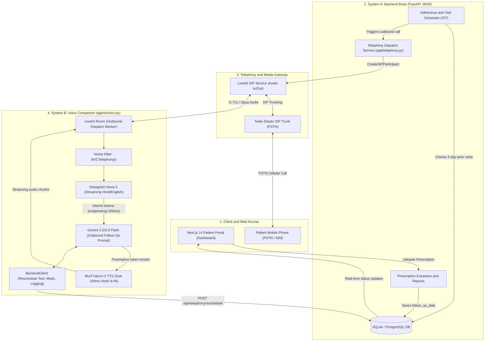
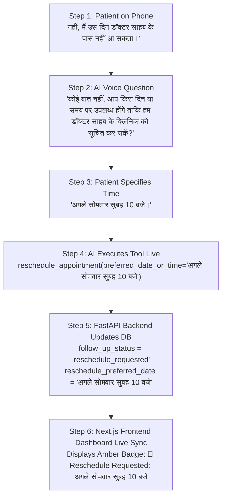
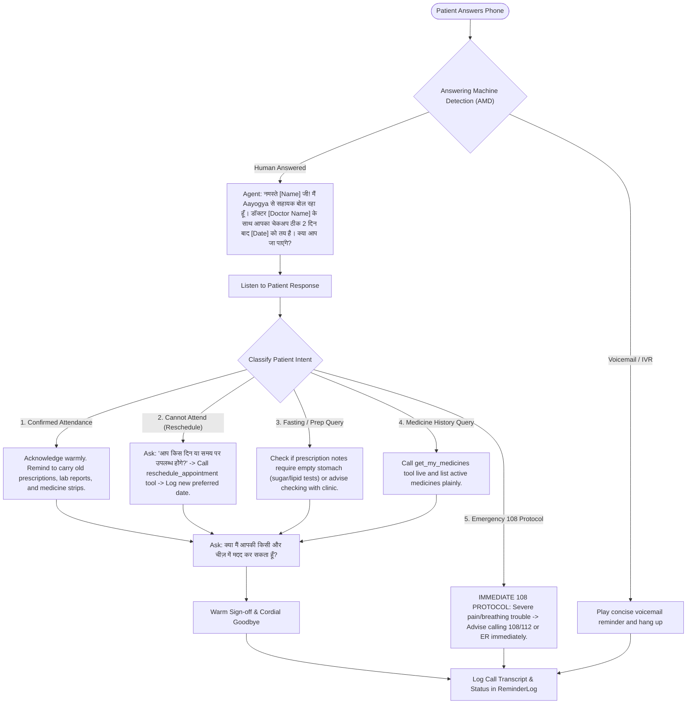

# Aayogya AI Telephony Voice Agent (System B — Outbound Telephony)

> **Objective:** An ultra-low latency, production-grade conversational telephony agent that autonomously calls patients **2 days prior** to their scheduled doctor review or medical checkup, verifies attendance, negotiates a new preferred time if the patient is unavailable, syncs the dashboard in real time, and answers live questions — starting strictly in **warm Hindi** with seamless **dynamic language switching**.

---

## 1. System Architecture & Zero-Latency Audio Pipeline

The following flowchart outlines the end-to-end connection between the **FastAPI Scheduler**, **Twilio Elastic SIP Trunk**, **LiveKit Telephony Gateway**, and the **Murf Falcon-2 + Deepgram + Gemini Streaming Brain**:



---

## 2. Sub-400ms "Zero Perceived Latency" Blueprint

Human conversational turnaround naturally averages **250ms–400ms**. To eliminate the awkward silence common in traditional voice bots, this pipeline uses streaming at every layer:

1. **Cellular Noise Filtering**:
   - LiveKit's `noise_cancellation.BVCTelephony()` cleans line hiss, ambient street sounds, and background speech before audio reaches speech recognition.
2. **Deepgram Nova-3 Streaming STT**:
   - Operates over bidirectional WebSockets with `interim_results=True` and `endpointing=250ms`. Speech boundary is recognized instantly without waiting for 1–2 seconds of dead silence.
3. **LiveKit Preemptive Token Streaming**:
   - `preemptive_generation={"preemptive_tts": True}` triggers Gemini token generation while the patient is finishing the final syllable of their sentence.
4. **Murf Falcon-2 Streaming TTS**:
   - Time-To-First-Byte (TTFB) is **sub-100ms**.
   - Uses `SentenceTokenizer(min_sentence_len=1)` and `text_pacing=True`. The very first phrase (e.g., *"जी रमेश जी,"*) begins playing into the phone speaker in **~300ms**, completely masking the LLM processing for the rest of the message.
5. **Worker Pre-warming**:
   - Silero VAD, Gemini client, and Murf Falcon connection pools are loaded in `prewarm()`, eliminating process cold-starts.

---

## 3. Patient Reschedule Negotiation & Dashboard Sync Flowchart

If the patient cannot attend the doctor's visit, the agent does not merely end the call. It asks when the patient will be free, captures their preferred date/time, and syncs the dashboard in real time:



---

## 4. Conversational Decision Tree (The Outbound Brain)



---

## 5. Language Protocol: Hindi-First with Dynamic Switching

1. **Strict Hindi Opening**:
   - The agent MUST always initiate the call in respectful, everyday Hindi written strictly in **Devanagari script** (देवनागरी):
     > *"नमस्ते [Name] जी! मैं Aayogya से सहायक बोल रहा हूँ। डॉक्टर [Doctor Name] के साथ आपका चेकअप ठीक 2 दिन बाद, [Date] को निर्धारित है। क्या आप जा पाएंगे?"*
   - *Rationale:* Writing in Latin letters ("namaste...") causes phonetic voice engines to read Hindi with an unnatural Western accent. Devanagari guarantees authentic Indian phonetics on Murf Falcon-2 (`voice="Shweta"`, `locale="hi-IN"`).
2. **Dynamic Language Switching**:
   - If the patient replies in **English** (*"Yes, I will be attending, what time is it?"*):
     - The agent seamlessly switches to fluent, polite English.
   - If the patient replies in **Hinglish** (*"Haan main jaunga, par mujhe fasting ka puchhna tha"*):
     - The agent replies in conversational Hindi/Hinglish.
   - If the patient switches back to **Hindi**:
     - The agent smoothly switches back to pure Hindi.

---

## 6. Environment Variables (`.env`)

Add the following telephony configuration to `backend/.env` and `agent/.env`:

```env
# --- Twilio Elastic SIP Trunking & Telephony ---
TWILIO_ACCOUNT_SID=ACxxxxxxxxxxxxxxxxxxxxxxxxxxxxxxxx
TWILIO_AUTH_TOKEN=xxxxxxxxxxxxxxxxxxxxxxxxxxxxxxxx
TWILIO_PHONE_NUMBER=+1234567890
TWILIO_SIP_TRUNK_DOMAIN=aayogya.pstn.twilio.com
TWILIO_SIP_USERNAME=aayogya_sip_user
TWILIO_SIP_PASSWORD=your_sip_password
LIVEKIT_SIP_TRUNK_ID=ST_xxxxxxxxxxxx

# --- LiveKit Cloud & Voice Engine ---
LIVEKIT_URL=wss://your-project.livekit.cloud
LIVEKIT_API_KEY=your_livekit_api_key
LIVEKIT_API_SECRET=your_livekit_api_secret

# --- Speech & AI Models ---
GOOGLE_API_KEY=your_gemini_api_key
GEMINI_MODEL=gemini-2.5-flash
DEEPGRAM_API_KEY=your_deepgram_api_key
DEEPGRAM_MODEL=nova-3
STT_LANGUAGE=multi
MURF_API_KEY=your_murf_api_key
MURF_VOICE=Shweta
MURF_LOCALE=hi-IN
MURF_MODEL=falcon-2
```

> **Zero-Key Development Mode:** If `TWILIO_ACCOUNT_SID` or `LIVEKIT_SIP_TRUNK_ID` is blank, the backend operates in **safe simulation mode** — logging the dispatch event, recording mock call payloads, and allowing 100% test coverage and UI testing without incurring telephony charges.

---

## 7. Database Schema Updates (`backend/app/models.py`)

### 1. `Report` Table Extensions
* `follow_up_status`: `Column(String, default="scheduled")`
  - Values: `scheduled` | `confirmed` | `reschedule_requested` | `completed`
* `reschedule_preferred_date`: `Column(String, nullable=True)`
  - Stores the patient's requested alternative date/time (e.g., *"अगले सोमवार सुबह 10 बजे"* or *"2026-10-20"*).
* `reschedule_notes`: `Column(String, nullable=True)`
  - Context/reason given by patient (e.g., *"Patient is out of town on Friday"*).
* `last_call_at`: `Column(DateTime, nullable=True)`

### 2. `ReminderLog` Table Extensions
* `call_duration_seconds`: `Column(Integer, nullable=True)`
* `call_status`: `Column(String, nullable=True)`
  - Values: `answered` | `no_answer` | `busy` | `voicemail` | `failed`

---

## 8. Backend Endpoints (`backend/app/main.py`)

| Method | Endpoint | Description |
|---|---|---|
| `POST` | `/api/telephony/dispatch` | Dispatches an outbound call for a given `report_id` and `patient_id`. Enforces daytime hours (09:00 - 20:00 IST). |
| `POST` | `/api/telephony/reschedule` | Authenticated tool endpoint invoked by the agent to record `preferred_date_or_time` and set `follow_up_status = "reschedule_requested"`. |
| `GET` | `/api/telephony/status/{report_id}` | Returns current follow-up status, latest call logs, and reschedule details. |
| `GET` | `/api/reports` | Returns report list including `follow_up_status` and `reschedule_preferred_date` for dashboard display. |

---

## 9. Frontend Dashboard Indicators (`frontend/components/sections.js`)

In the Patient Dashboard's **Prescriptions & Upcoming Checkups** card:
* If `follow_up_status === "reschedule_requested"`:
  - 🔄 **Amber Badge**: `Reschedule Requested: [reschedule_preferred_date]`
  - Note: *"Clinic notified of preferred time"*
* If `follow_up_status === "confirmed"`:
  - ✓ **Green Badge**: `Attendance Confirmed by Patient`
* If `follow_up_status === "scheduled"`:
  - 📅 **Blue Badge**: `Review on [follow_up_date]`

---

## 10. Automated Testing & Verification Plan

1. **`backend/test_telephony.py`**:
   - Verifies 2-day-prior trigger logic and time-window restrictions.
   - Verifies `CreateSIPParticipant` payload generation and zero-key simulation fallback.
   - Verifies `POST /api/telephony/reschedule` database updates.
2. **`agent/test_followup.py`**:
   - Asserts system prompt mandates Devanagari Hindi for initial greeting.
   - Verifies dynamic language code-switching instructions.
   - Verifies `@function_tool reschedule_appointment` signature and mock execution.
